# Intelligent Infrastructure Automation Platform
## Architecture / System Design Document

---

## 1. System Overview

The Intelligent Infrastructure Automation Platform is a web-based deployment automation system aimed at developers with little or no DevOps experience. A user registers an application (its source repository and a small amount of configuration), and the platform takes over the process of building that application into a container image, storing the image in a registry, and deploying it to Kubernetes behind a public URL.

Conceptually, the platform automates this pipeline:

```text
User → Application Configuration → Source Repository → Build → Docker Image → Registry → Kubernetes Deployment → Public URL
```

The system is not a single monolithic application. It is composed of four cooperating microservices — **Auth Service**, **Application Service**, **Build Service**, and **Deployment Service** — sitting behind an API Gateway, backed by Django + Django REST Framework, using Celery for background work, Jenkins for build execution, Docker Hub as the initial registry, and Kubernetes as the runtime environment.

This document defines the **boundaries** between these pieces: who owns what, who talks to whom, when they talk synchronously versus asynchronously, and how data and identity flow through the system. It deliberately stops short of internal service design (database schemas, endpoints, Celery task signatures, Kubernetes manifests) — that is the subject of later, per-service documents.

**Application Service implementation:** the standalone service in `application_service/` uses Node.js, Express, and PostgreSQL, while the other services can use Django. Its [service contract and setup](app%20service.md) supersede this overview's earlier HTTP build-handoff proposal: build requests are published directly to the agreed Redis/Celery queue, and results arrive through a service-authenticated HTTP callback.

---

## 2. Architectural Goals

- **Low ceremony for the end user.** A developer with no Kubernetes or CI/CD background should be able to go from "here's my repo" to "here's my URL" with minimal configuration.
- **Clear ownership.** Every piece of data and every step of the pipeline has exactly one service responsible for it.
- **Independent evolution.** Each service should be buildable, deployable, and scalable without forcing changes on the others.
- **Resilience to long-running work.** Building and deploying are slow, potentially flaky operations; they must never block the request/response cycle of the API.
- **Security by boundary, not by convention.** Authentication is centralized; authorization is distributed to whoever owns the resource being protected.
- **Extensibility.** New application runtimes, new build backends, new registries, or new deployment targets should be addable without redesigning the whole system.
- **Operational transparency.** At any point, it should be possible to answer "what state is this application in, and why" by inspecting a small, well-defined set of services.

---

## 3. Architectural Principles

1. **One service, one domain of ownership.** Auth owns identity. Application Service owns the user's application metadata. Build Service owns the source-to-image transformation. Deployment Service owns the image-to-running-workload transformation.
2. **No shared databases.** Services never read or write another service's tables directly. Cross-service references are by identifier (e.g., an `application_id` UUID), not by foreign key.
3. **Stateless authentication verification.** Any service that needs to know "who is this user" verifies a signed token locally; it does not ask the Auth Service to confirm identity on every request.
4. **Synchronous calls are for orchestration decisions; asynchronous messaging is for work.** A service asks another service a quick question over HTTP. A service asks a worker to *do* something over Celery.
5. **The control plane is not the runtime plane.** The four services and their infrastructure (Jenkins, Celery brokers, internal databases) form the platform itself. The applications the platform deploys for users form a separate, isolated runtime environment.
6. **Fail loudly and locally.** A failure in one stage of the pipeline (e.g., a build failure) should be contained, recorded, and reported — it should not corrupt the state of unrelated services.
7. **Design for the boundary first, the implementation second.** Internal schema and code decisions inside a service should never require renegotiating what that service exposes to the rest of the system.

---

## 4. Service Boundaries

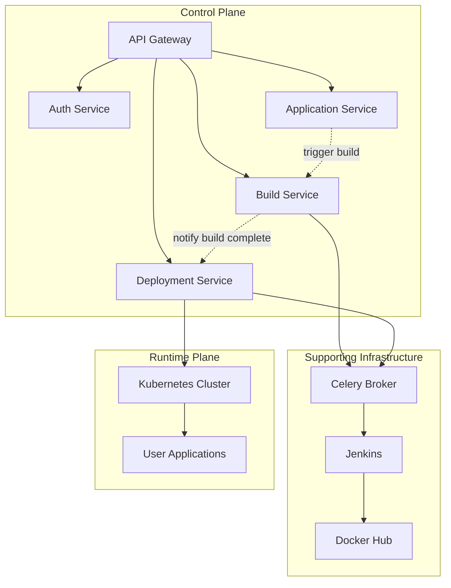

Each of the four services owns:

| Service | Owns | Does Not Own |
|---|---|---|
| Auth Service | User identity, credentials, token issuance | Application data, build/deploy state, authorization rules of other domains |
| Application Service | Application records, high-level configuration, ownership mapping (user → app) | How the app is built, how it is deployed |
| Build Service | Source-to-image transformation, build history/status | Application configuration semantics, deployment lifecycle |
| Deployment Service | Image-to-running-workload transformation, deployment lifecycle/state | How the image was produced |

The boundaries follow the natural stages of the pipeline described in the System Overview: identity is orthogonal to the pipeline, while Application → Build → Deployment mirrors the actual left-to-right flow of a user's app going live.

---

## 5. Responsibilities of Each Service

### 5.1 Auth Service
Owns user identity and authentication. Responsible for registration, login, credential management, and issuing signed tokens that represent "this request comes from this authenticated user." It is the single source of truth for *who* a user is. It is explicitly **not** responsible for deciding what a user is allowed to do with an application, a build, or a deployment — that is domain-specific authorization, handled by the service that owns the resource.

### 5.2 Application Service
Owns the concept of a "user's application" — its name, its repository location, its runtime type (Django/Flask/Node.js/React), and whatever minimal configuration the user provides. It is the entry point of the pipeline: when a user wants to go from "I have code" to "I have a URL," they start here. It initiates builds but does not perform them.

### 5.3 Build Service
Owns the transformation of source code into a container image:

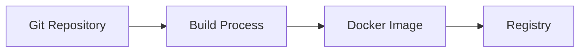

It may coordinate with Jenkins, Docker, Git providers, and Docker Hub to accomplish this, but exactly how it does so is internal detail, out of scope here. What matters at the architecture level is its contract: given a reference to source code and build configuration, it produces (eventually, asynchronously) a container image in a registry, and it exposes the status of that process.

### 5.4 Deployment Service
Owns the transformation of a built image into a running, publicly reachable application:

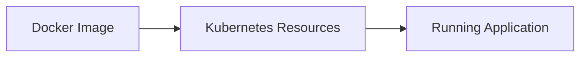

It owns the deployment lifecycle — creating, updating, scaling down, tearing down — but it does not own or re-derive how the image was produced. It trusts the image reference it is given.

---

## 6. Control Plane vs Runtime Plane

This platform is best understood as a small **Internal PaaS**, not a script. That framing implies a strict separation between the plane that *manages* deployments and the plane where user applications actually *run*.

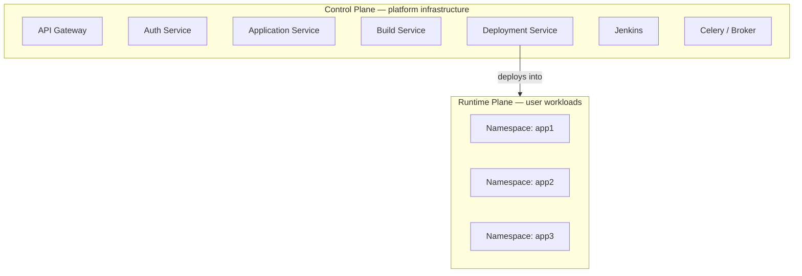

- The **control plane** is infrastructure the platform team operates: the four services, Jenkins, the Celery brokers, and the internal databases. Its availability determines whether users can create, build, or deploy applications.
- The **runtime plane** is where already-deployed user applications actually execute and serve traffic. Its availability determines whether *already-running* applications stay up.

This separation matters architecturally for two reasons:

1. **Blast radius.** If the control plane goes down, existing deployed applications should keep running — they don't depend on Auth Service or Build Service being up at request-serving time. Only *changes* (new builds, new deployments) are affected.
2. **Trust boundary.** User workloads are untrusted, potentially resource-hungry, and multi-tenant. They must be isolated (e.g., via Kubernetes namespaces, network policies, resource quotas) from the platform's own infrastructure, which is trusted and shared.

---

## 7. Authentication and Authorization Architecture

### 7.1 Authentication vs Authorization
These are deliberately separated concerns:

- **Authentication** answers *"who is making this request?"* It is a single, centralized concern owned by the Auth Service.
- **Authorization** answers *"is this identified user allowed to do this specific thing to this specific resource?"* It is inherently domain-specific — only the Application Service knows whether a user owns a given application; only the Deployment Service knows whether a user is allowed to redeploy a given workload. Authorization is therefore distributed across the domain services, each enforcing rules over its own resources.

Centralizing authentication while distributing authorization avoids two anti-patterns: (a) every service reinventing login/credential logic, and (b) a single service becoming an authorization bottleneck that has to understand every other service's domain rules.

### 7.2 Why Auth Service Owns Identity
Identity (accounts, credentials, password resets, sessions) is a cross-cutting concern used by every other service. Centralizing it means:
- One place to secure credential storage.
- One consistent notion of "user" across the whole platform.
- Other services never need to store or manage passwords — they only need to *trust a signed statement* about who the caller is.

### 7.3 Asymmetric JWTs and Local Validation
The Auth Service holds a **private key** and uses it to sign JWTs at login/token-issue time. Every other service holds only the corresponding **public key** and uses it purely to *verify* a token's signature — never to issue one.

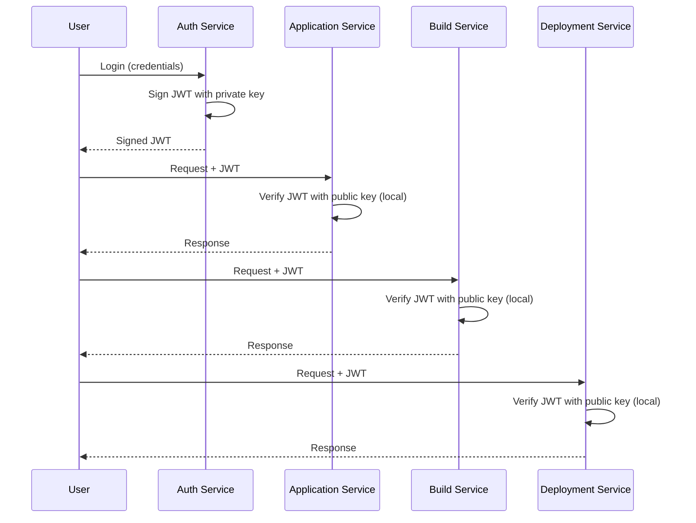

This asymmetric design is what allows the explicit constraint of this project to hold: **other services must not call Auth Service on every request just to validate a token.** Because verification only requires the public key (which can be distributed to every service ahead of time, e.g., via configuration or a shared secret store), each service can independently confirm a token's authenticity and integrity without a network round-trip to Auth Service. Auth Service is only involved at token *issuance* (login, refresh) — not at every subsequent authenticated request.

### 7.4 Conceptual Role of Issuer / Audience / Expiration
Even without defining the concrete claims schema, three concepts matter architecturally:
- **Issuer** — identifies that the token genuinely came from this platform's Auth Service, not a forged or foreign source.
- **Audience** — conceptually scopes who the token is meant for, so a token cannot be silently repurposed outside its intended context.
- **Expiration** — bounds the window in which a compromised or leaked token remains usable, forcing periodic re-authentication rather than indefinite trust.

These three concepts are what let a locally-verified token be *safely* trusted without contacting Auth Service, because expiration limits exposure and issuer/audience checks limit misuse.

### 7.5 Authorization Remains Domain-Specific
Once a service has established *who* the caller is (via JWT verification), it is that service's own responsibility to decide *what* the caller may do. Application Service checks application ownership before allowing edits; Build Service checks whether the caller may trigger a build for a given application; Deployment Service checks whether the caller may redeploy or tear down a given deployment. None of this authorization logic lives in Auth Service — pushing it there would force Auth Service to understand every other domain's rules, recreating a central bottleneck the architecture is trying to avoid.

### 7.6 Identity Propagation Between Services
When a service calls another service on the user's behalf (e.g., Application Service triggering a build in Build Service), the originating user's identity is propagated forward — conceptually, by forwarding the same verifiable token or an equivalent trusted claim — rather than the downstream service treating the request as coming from the upstream service itself. This preserves the ability to answer "which user ultimately caused this build/deployment" throughout the pipeline, and lets each downstream service apply its own authorization checks against the *real* originating user, not just against "some internal service called me."

---

## 8. Service-to-Service Communication

Two distinct communication patterns exist in this system, chosen for different reasons.

### 8.1 Synchronous (HTTP/API)
Used when a service needs an **immediate answer** to make a decision or fulfill a request within the current request/response cycle — for example, Application Service asking Build Service "please start a build for this application" and getting back an acknowledgment (accepted, queued) so it can tell the user their build has begun.

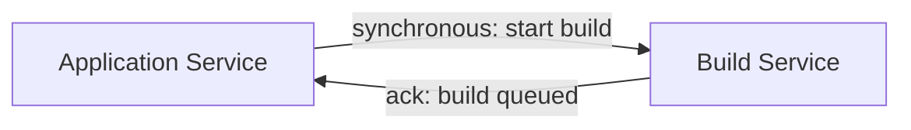

Synchronous calls are appropriate when:
- The operation is fast (creating a record, validating a reference, returning current status).
- The caller genuinely needs the result before it can respond to its own caller.
- The operation does not itself take an unpredictable or long amount of time.

### 8.2 Asynchronous (Celery / Messaging)
Used for the actual long-running work — building an image, provisioning Kubernetes resources — which must never block an HTTP request/response cycle.

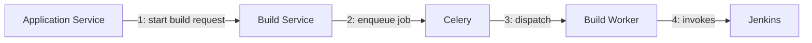

and downstream:

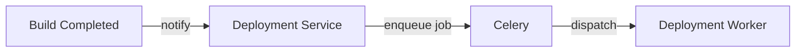

Asynchronous messaging is appropriate when:
- The operation may take seconds to minutes (or longer) and has no place in an HTTP timeout window.
- The operation may need retries, backoff, or queuing under load.
- The caller only needs to know that work *has been accepted*, not that it has *completed*, at the moment of the call.
- Progress/completion needs to be observed later (via polling, status endpoints, or events) rather than returned inline.

### 8.3 Why Both Are Needed
If everything were synchronous, a single slow build would tie up an HTTP connection for potentially many minutes, and any transient failure in Jenkins or Docker would surface as a failed user-facing request rather than a retryable background job. If everything were asynchronous, even trivial, fast operations (like "does this application exist") would require unnecessary indirection and polling. The architecture uses synchronous calls for orchestration/handshake ("I want this to happen, has it started?") and asynchronous messaging for execution ("actually go do it, and tell me later how it went").

---

## 9. Synchronous vs Asynchronous Workflows

| Interaction | Pattern | Rationale |
|---|---|---|
| User authenticates | Synchronous | Needs an immediate token to proceed |
| Application Service verifies a JWT | Local (no call at all) | Verification is cryptographic, not a lookup |
| Application Service asks Build Service to start a build | Synchronous request, asynchronous execution | The *request* is fast; the *build* is not |
| Build Service performs the actual build | Asynchronous (Celery → Worker → Jenkins) | Long-running, retryable, must not block |
| Build Service notifies Deployment Service that an image is ready | Synchronous or event-based handoff, triggering asynchronous work | The notification is quick; the deployment itself is not |
| Deployment Service provisions Kubernetes resources | Asynchronous (Celery → Worker → Kubernetes) | Long-running, involves external cluster state, must not block |
| User polls for build/deployment status | Synchronous (read-only status check) | Status lookups are cheap and immediate |

The general rule that emerges: **synchronous where the answer is a fast decision; asynchronous where the answer is a slow outcome.**

---

## 10. Celery's Architectural Role

Celery is the platform's mechanism for deferring and distributing long-running work away from the request/response cycle. Architecturally, it sits *inside* Build Service and Deployment Service (each service has its own workers and, conceptually, its own task queues) rather than as a shared, cross-cutting component that all services dump work into indiscriminately.

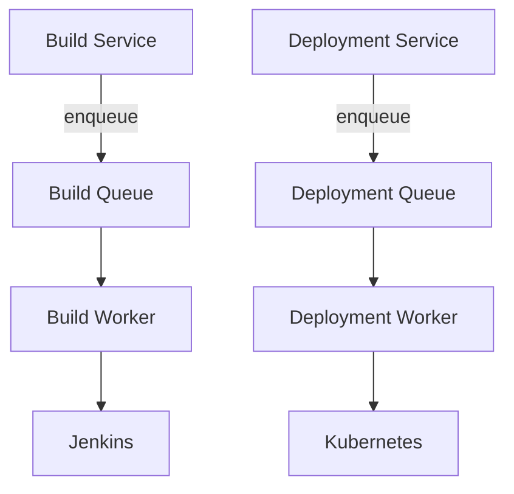

Its architectural responsibilities:
- **Decoupling request handling from execution.** The web-facing part of a service accepts a request and returns quickly; the worker does the actual work independently.
- **Retryability.** Transient failures (e.g., Jenkins momentarily unavailable) can be retried without the user having to re-initiate anything.
- **Backpressure and queuing.** Under load, work queues rather than overwhelms the build/deployment infrastructure.
- **Status reporting.** As a task progresses, the owning service can update the state it exposes to callers, without the caller having stayed connected the whole time.

The broker (Redis or RabbitMQ) is an implementation detail of *how* Celery moves messages between services and their workers — an architectural choice worth naming, but not one that changes the service boundaries themselves. Redis is simpler operationally and often sufficient for early-stage queuing needs; RabbitMQ offers more robust delivery guarantees and routing semantics at the cost of additional operational complexity. This choice can be deferred or revisited without affecting any service boundary defined in this document.

---

## 11. Database Ownership and Data Boundaries

Each service owns its own database, and only its own database. No service reads or writes another service's tables, and there are no cross-service Django `ForeignKey` relationships.

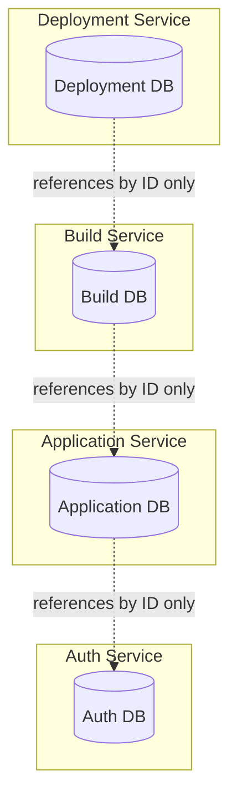

Where one service's data conceptually relates to another's (e.g., an application record in Application Service belongs to a user in Auth Service; a build record in Build Service belongs to an application in Application Service), the relationship is represented by storing an **identifier** (e.g., a UUID), not a foreign key into another service's schema, and resolved — when needed — via service-to-service communication rather than a database join.

### Why not a shared database?
A shared database (or cross-service foreign keys) would look convenient early on but would quietly recreate a monolith at the data layer:
- **Coupled schema evolution.** A migration in one service's tables could break another service's queries, even though the services are supposedly independent.
- **Coupled deployment.** Services could no longer be deployed, scaled, or even taken offline independently, since they'd share a single point of data consistency.
- **Blurred ownership.** It becomes ambiguous which service is actually responsible for the correctness of a given piece of data, undermining the entire premise of "one service, one domain."
- **Harder failure isolation.** A database outage would take down every service at once rather than being contained to the service that owns it.

Keeping databases separate is what makes the "one service, one domain of ownership" principle (Section 3) enforceable rather than aspirational.

---

## 12. High-Level Build Workflow

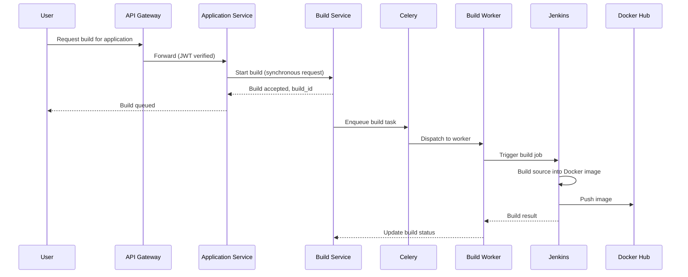

At each stage, responsibility is bounded:
- **API Gateway** routes the request and ensures a valid token is present.
- **Application Service** confirms the application exists and the caller owns it, then delegates to Build Service — it does not know or care *how* a build happens.
- **Build Service** accepts the request, records a build entity, and hands the actual work to Celery — it does not block the HTTP response waiting for Jenkins.
- **Celery/Worker** performs the asynchronous handoff to Jenkins and reports outcomes back.
- **Jenkins** performs the actual build and pushes the resulting image to Docker Hub — the specifics of *how* Jenkins does this are out of scope here.
- **Docker Hub** stores the resulting image, to be referenced (by tag/digest) later.

---

## 13. High-Level Deployment Workflow

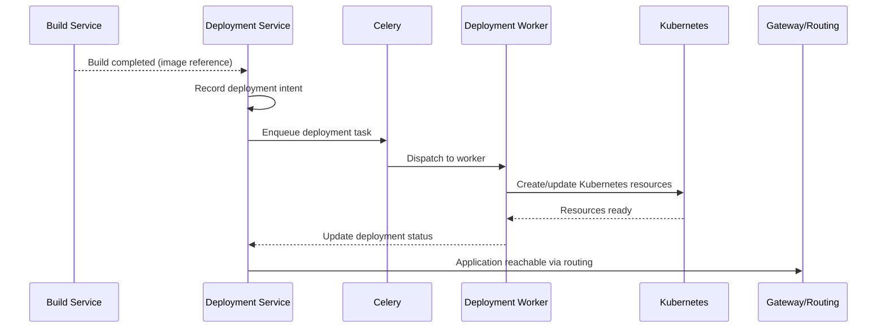

Deployment Service does not re-derive or validate how the image was built — it trusts the image reference handed to it by Build Service (subject to whatever minimal validation belongs at that boundary, such as confirming the image reference is well-formed). Its job begins where Build Service's job ends: turning a container image into a running, network-reachable workload.

---

## 14. External Access / Gateway / Domain Architecture

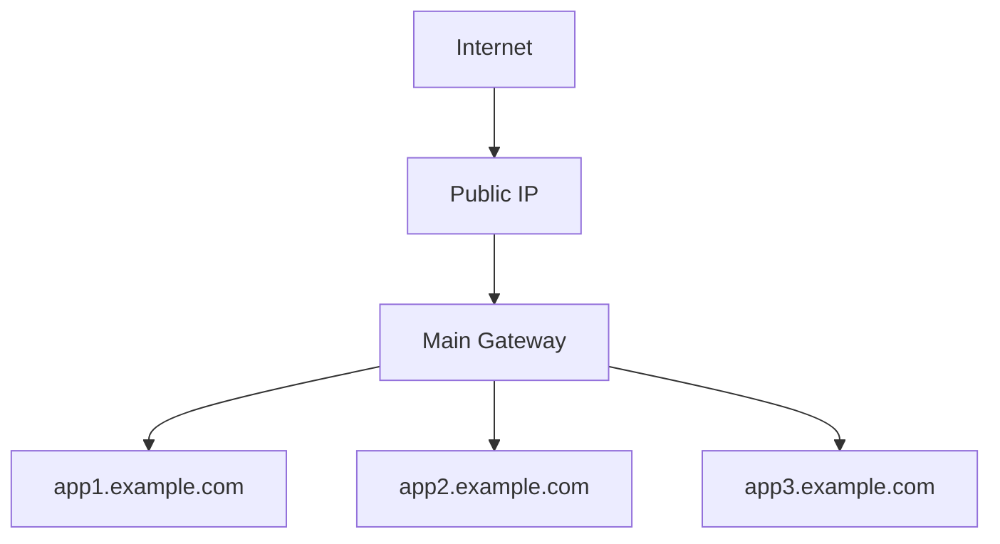

- **One shared external entry point.** Rather than giving every deployed application its own public IP/load balancer, all traffic enters through a single shared gateway. This is simpler to secure, monitor, and scale, and avoids the cost/complexity of provisioning per-application public infrastructure.
- **Domain/subdomain-based routing.** Each deployed application is reachable via its own subdomain, and the gateway routes incoming requests to the correct backend workload based on hostname. This gives each user application the appearance of an independent public service without requiring independent infrastructure.
- **Routing from gateway to application.** Internally, the gateway resolves a hostname to the specific Kubernetes service/workload for that application — a routing concern owned by the runtime plane, configured (indirectly) as an outcome of the Deployment Service's work, not something Deployment Service implements by hand per request.
- **Separation of control plane and user workload traffic.** The platform's own API traffic (to Auth/Application/Build/Deployment Service, via the API Gateway in Section 4) is architecturally distinct from the public traffic hitting deployed user applications (via the Main Gateway in this section). These may be the same physical technology (e.g., both could be a Kubernetes Gateway API implementation) but they serve different trust domains and should be reasoned about separately: one gates access to the platform itself, the other routes public traffic to tenant applications.

---

## 15. End-to-End System Flow

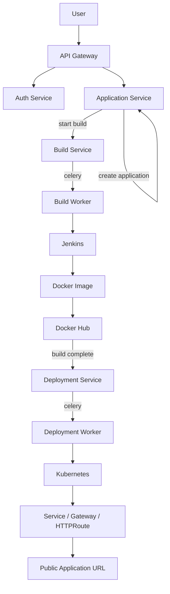

Read end to end: a user authenticates once via Auth Service and carries a verifiable token into every subsequent interaction. They register an application with Application Service, which — on request — hands off to Build Service. Build Service performs the source-to-image transformation asynchronously via Celery and Jenkins, landing an image in Docker Hub. Once built, Deployment Service takes over, asynchronously provisioning Kubernetes resources for that image. Once those resources are live, the platform's routing layer exposes the application at a public, subdomain-based URL.

---

## 16. Failure Boundaries and Major Failure Scenarios

Because each service owns a distinct stage, failures are expected to be *contained* to the stage in which they occur, rather than cascading.

| Failure | Contained To | Effect Elsewhere |
|---|---|---|
| Auth Service is down | New logins/token issuance | Already-issued, unexpired JWTs still verify locally elsewhere — other services keep working for already-authenticated users |
| Application Service is down | Creating/editing applications, initiating new builds | Existing builds/deployments in progress are unaffected; already-deployed applications keep serving traffic |
| Build Service is down | Starting or completing new builds | Existing deployments keep running; Application Service can still serve reads |
| Jenkins is unavailable | Build execution specifically | Build Service can queue/retry; other services unaffected |
| Celery broker is down | All asynchronous work across affected service(s) | Synchronous reads/status checks may still work; new async work queues up or fails depending on broker semantics |
| Deployment Service is down | Starting or updating deployments | Already-running applications keep serving traffic (runtime plane is independent of control plane availability) |
| Kubernetes cluster issues | Runtime plane — actual application availability | Control plane services (Auth/Application/Build) can remain up even if deployed apps degrade |
| Docker Hub is unavailable | Pushing new images, pulling images for new deployments | Already-running deployments using already-pulled images are unaffected |

This table illustrates why the control-plane/runtime-plane separation (Section 6) matters operationally, not just conceptually: most control-plane failures degrade the platform's ability to *change* things, not its ability to *keep already-deployed things running*.

---

## 17. Security Boundaries

- **Identity is centralized, trust is distributed.** Only Auth Service can mint tokens (it alone holds the private key); every other service can only verify, never issue — limiting the blast radius of a compromised non-Auth service.
- **Authorization stays local to the owning domain.** No service other than the resource owner enforces access rules on that resource, preventing authorization logic from drifting out of sync with the data it protects.
- **Runtime plane isolation.** User-deployed applications run in isolated Kubernetes constructs (namespaces, network policies, resource quotas — detailed design deferred) separate from the control plane's own infrastructure, limiting what a compromised or misbehaving user application could reach.
- **Registry and build credentials belong to Build Service alone.** Neither Application Service nor Deployment Service needs, and should not hold, credentials to Docker Hub or Jenkins — narrowing the set of components that could leak build-time secrets.
- **Cluster credentials belong to Deployment Service alone.** Similarly, only Deployment Service should hold credentials capable of provisioning Kubernetes resources.
- **Public entry points are minimized.** A single shared gateway for the control plane's API and a single shared gateway for routed user traffic (Section 14) reduce the platform's overall external attack surface compared to exposing each service or each deployed application independently.

---

## 18. Scalability Considerations

- **Independent horizontal scaling.** Because each service owns its own data and communicates over well-defined boundaries, each can be scaled independently based on its own load profile (e.g., Build Service workers scaling with build volume, independent of Application Service's read traffic).
- **Asynchronous work naturally load-levels.** Celery queues absorb bursts of build/deployment requests without requiring the web-facing parts of Build/Deployment Service to scale in lockstep with worker capacity.
- **Stateless JWT verification scales trivially.** Because token verification requires no call back to Auth Service, adding more instances of any domain service does not increase load on Auth Service.
- **Runtime plane scales separately from control plane.** The number and size of deployed user applications (runtime plane) can grow independently of the four control-plane services, since Kubernetes itself absorbs that scaling concern.
- **Broker choice affects throughput characteristics**, not architecture: Redis favors simplicity and speed for moderate volumes; RabbitMQ favors durability and complex routing at higher operational cost. This can be tuned later without touching service boundaries.

---

## 19. Technology Responsibilities

| Technology | Responsibility in the Architecture |
|---|---|
| Django + DRF | Web-facing framework for all four services; exposes each service's API surface |
| Celery | Asynchronous task execution within Build Service and Deployment Service |
| Redis / RabbitMQ | Message broker moving tasks from services to their Celery workers |
| Jenkins | Executes the actual build process on behalf of Build Service |
| Docker | Produces the container image artifact during the build process |
| Docker Hub | Stores built container images, referenced later by Deployment Service |
| Kubernetes | Runtime environment for deployed user applications; provisioned by Deployment Service |
| API Gateway | Single entry point for control-plane API traffic; routes to the four services |
| Main Gateway / Routing | Single entry point for public traffic to deployed user applications, routed by domain/subdomain |

Each technology maps to exactly one architectural responsibility, avoiding tools that quietly span multiple service boundaries (e.g., no shared Jenkins credentials used outside Build Service, no shared cluster credentials used outside Deployment Service).

---

## 20. Architectural Decisions and Their Rationale

| Decision | Alternatives Considered | Trade-off / Rationale |
|---|---|---|
| Four separate services vs. a single monolith | Monolithic Django app handling auth, apps, builds, and deployments | A monolith is simpler initially but couples deployment, scaling, and failure domains for fundamentally different concerns (identity vs. long-running infra automation). Four services align with natural boundaries and allow independent scaling/failure isolation, at the cost of added operational complexity (more services to deploy/monitor). |
| Asymmetric JWT (public/private key) vs. symmetric token + central validation service | Every service calls Auth Service to validate each token (session-based or introspection-based) | Central validation is simpler to reason about but makes Auth Service a bottleneck and single point of failure for *every* request across the platform. Asymmetric JWTs trade a small amount of added key-management complexity for the ability to verify tokens locally, matching the explicit non-negotiable requirement of this project. |
| Per-service databases vs. shared database | Shared database with cross-service foreign keys | A shared database is faster to build initially but recreates monolithic coupling at the data layer (Section 11) and undermines independent deployability. Per-service databases preserve boundaries at the cost of needing service-to-service calls to resolve cross-service relationships. |
| Redis vs. RabbitMQ as Celery broker | Either is viable | Redis is operationally simpler and sufficient for moderate throughput; RabbitMQ offers stronger delivery guarantees and richer routing at higher operational overhead. This is treated as a deferred, swappable decision rather than a structural one. |
| Jenkins as build executor vs. a cloud-native build system (e.g., Kaniko, Buildpacks-based pipelines, Tekton) | Various | Jenkins is well-understood, broadly documented, and sufficient for an initial implementation; more cloud-native, Kubernetes-integrated build systems could reduce operational surface later but add adoption complexity now. Chosen for v1 pragmatism, explicitly revisitable. |
| Docker Hub as registry vs. a private/self-hosted registry | Private registry (e.g., Harbor), cloud provider registry | Docker Hub minimizes initial operational burden; a private registry would offer more control over retention, access, and possibly cost at scale, and is a natural future evolution once usage grows. |
| Single shared gateway with subdomain routing vs. per-application public endpoints | Provisioning a dedicated LoadBalancer/IP per deployed application | Per-application public endpoints are simpler per-app but expensive and harder to secure/monitor at platform scale. A shared gateway with subdomain routing centralizes TLS, monitoring, and access control, at the cost of that gateway becoming a critical shared component. |

---

## 21. Future Evolution / Where Additional Services Could Appear

The current four-service structure is intentionally minimal and should not be expanded without clear need. That said, several natural extension points exist:

- **Notification Service** — to own email/webhook/in-app notifications about build and deployment status, decoupling "something happened" from "someone needs to be told."
- **Billing/Usage Service** — if the platform introduces usage-based limits or paid tiers, a dedicated service could own metering and billing, keeping that logic out of Application/Build/Deployment Service.
- **Secrets Management Service** — as user applications grow more complex, a dedicated boundary for managing user-supplied secrets/environment variables (rather than folding this into Application Service) may become warranted.
- **Registry abstraction** — evolving Build Service's registry interaction from "talks to Docker Hub" to "talks to a pluggable registry interface" would allow supporting private registries or multiple registries without changing Build Service's external contract.
- **Build backend abstraction** — similarly, evolving from "talks to Jenkins" to a pluggable build-executor interface would allow swapping in cloud-native build systems later without changing Build Service's contract with the rest of the platform.
- **Multi-cluster / multi-region deployment** — Deployment Service's contract ("give me an image, I'll make it run") is already compatible with eventually targeting more than one Kubernetes cluster; this would primarily affect its internal implementation, not its external boundary.
- **Additional runtime support** — new application types beyond Django/Flask/Node.js/React are expected to be additive to Application Service's and Build Service's internal logic, not structural changes to the service boundaries defined here.

The guiding rule for all future evolution: a new service should only be introduced when a genuinely new domain of ownership emerges — not merely to relieve an existing service of implementation complexity that still belongs to its domain.

---

*This document defines architecture and boundaries only. Database schemas, REST endpoints, Celery task signatures, Kubernetes manifests, and Jenkins pipeline definitions are intentionally deferred to per-service design documents.*
