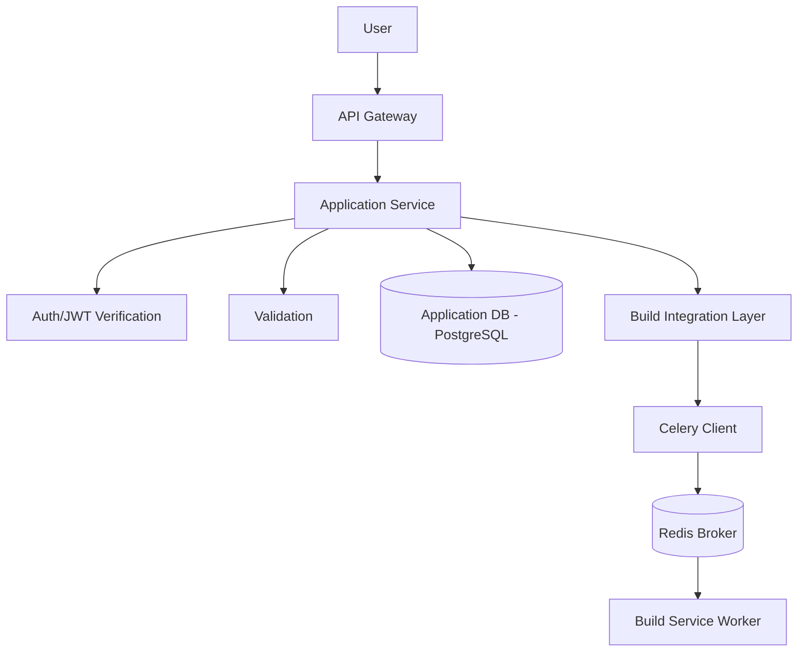
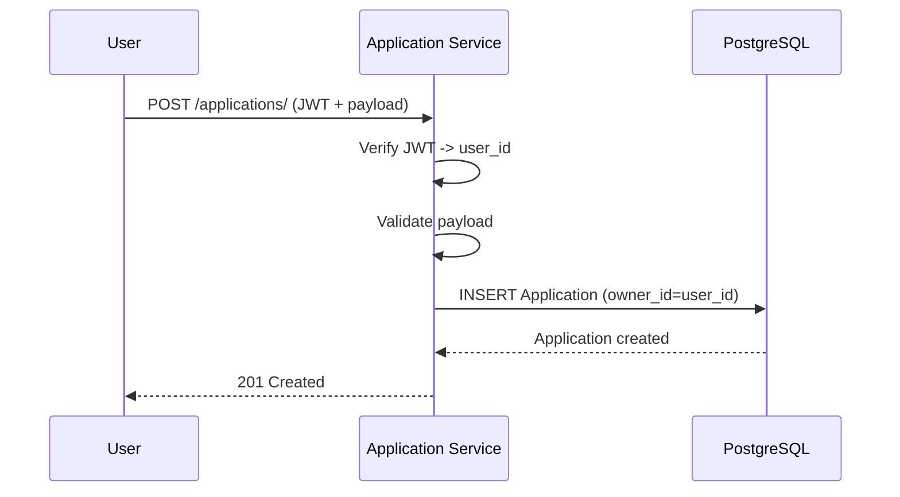
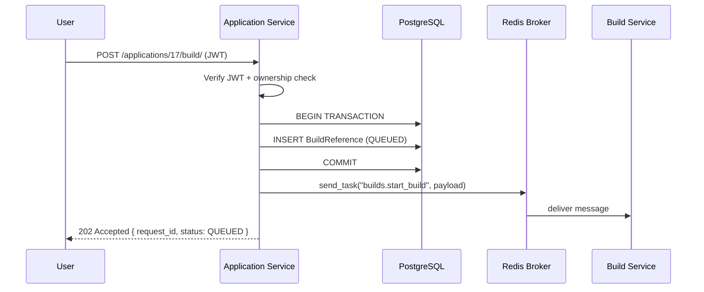
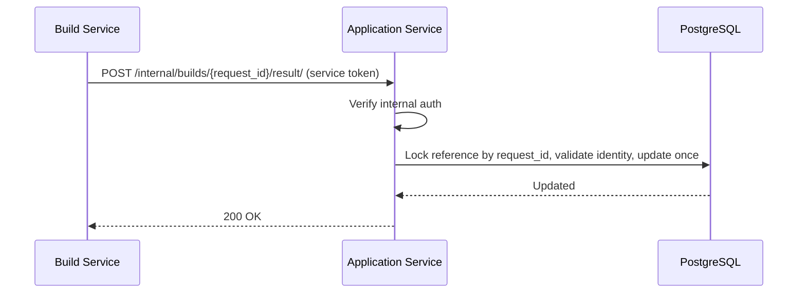
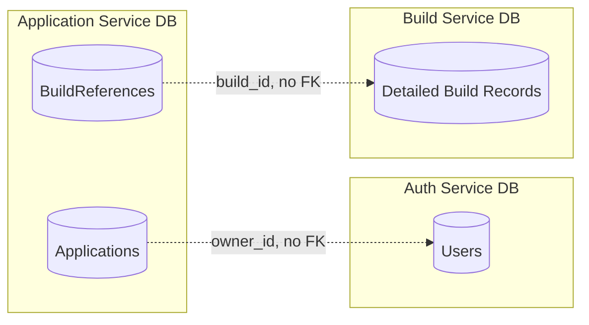
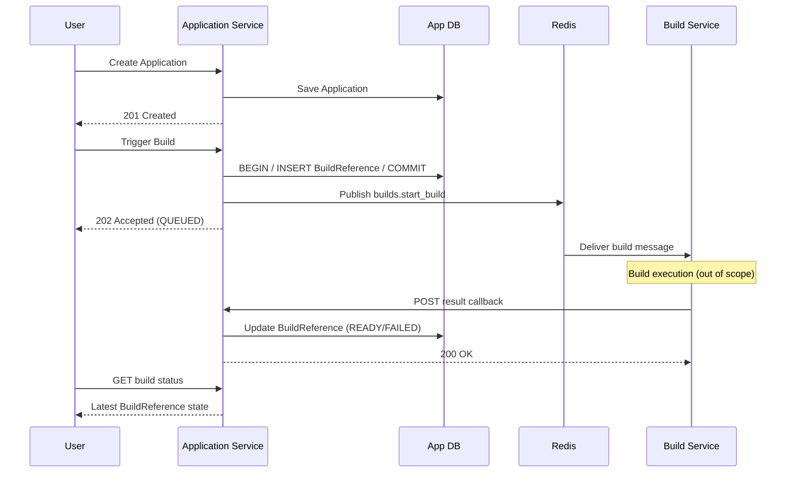

# Application Service

Part of the **Intelligent Infrastructure Automation Platform** — a microservices-based deployment platform.

**Implementation:** `application_service/` is a standalone **Node.js service**, written in plain JavaScript with Express and PostgreSQL. The other services may use Django. There are no shared models, Python imports, or cross-service database connections.

This per-service contract takes precedence over the older system overview where it describes an HTTP build handoff. The implemented handoff is **Node.js -> Redis/Celery -> Django Build Service**, with an authenticated HTTP callback in the reverse direction.

## Developer Quick Start

Requirements: Node.js **22.13+** (Docker uses Node 24), PostgreSQL, Redis, and the Auth Service's **PEM/SPKI public key**. Python is only needed for the optional Celery compatibility test, not to run this service.

Run commands from `application_service/`. Configure `.env` using the variables in `.env.example`; set the public-key path, agreed issuer/audience, database/broker URLs, and a random `BUILD_SERVICE_TOKEN` of at least 32 characters. Never put the Auth Service's private key here.

```sh
npm ci
npm run migrate
npm start
```

`npm run dev` enables Node's file watcher. Alternatively, `docker compose up --build` starts PostgreSQL, Redis, a one-shot migration job, and the API. The Compose profile is for local development: database and broker ports bind to localhost, and production must use managed credentials, private networking, and TLS. Use a URL-safe database password in this profile because Compose embeds it in `DATABASE_URL`.

The API defaults to `http://localhost:3000`. `GET /health/live/` and `GET /health/ready/` are unauthenticated health endpoints. Readiness checks PostgreSQL, not Redis: a broker outage must not take application reads offline. Migrations are explicit, never run silently by the API process.

```sh
npm test
npm run lint
npm run format:check
```

The default suite uses PGlite, an in-process PostgreSQL engine, without external services. Set `TEST_DATABASE_URL` to run the same suite against a real PostgreSQL server, including the multi-connection locking test. It creates and removes its own isolated test schema. To exercise the actual Node Redis publisher against Python Kombu/Celery with a local Redis protocol emulator:

```sh
python -m pip install -r test/requirements-celery.txt
npm run test:celery
```

Use an isolated Python environment. An alternative interpreter can be passed with `npm run test:celery -- /path/to/python`. This verifies Redis TCP publication, Kombu decoding, message redelivery, and execution of a test Celery task. Verified locally against **Celery 5.7.0 and Kombu 5.7.0**. It does not replace an end-to-end test against the team's real worker and Redis deployment.

### What Teammates Need

| Developer | Agreed connection |
|---|---|
| Auth Service | RS256 public key, matching `JWT_ISSUER` / `JWT_AUDIENCE`, and access-token claims `user_id`, `token_type: "access"`, `exp`, `iss`, `aud` |
| Build Service | Same Redis broker URL/database and `CELERY_KEY_PREFIX`, logical queue `build`, task `builds.start_build`, one positional JSON snapshot |
| Build Service callback | `POST /internal/builds/{request_id}/result/`, with `Authorization: Bearer <BUILD_SERVICE_TOKEN>`; optional `/started/` notification |
| Frontend | Gateway routes `/applications/` to this service; user JWT bearer header; list responses have `count`, `next`, `previous`, `results` |
| Deployment Service | No direct coupling is added here. Build Service remains responsible for its deployment handoff. `READY` here means an image was built, not deployed. |

In the supplied Compose network (`infraops`), the broker is `redis://broker:6379/0` and this service is `http://application-service:3000`. Other Compose projects can join that network as an external network. Outside Compose, use the actual reachable hostnames. Never use `localhost` to address another container.

The Django Auth Service should configure SimpleJWT's `ALGORITHM="RS256"`, `ISSUER`, `AUDIENCE`, and `USER_ID_CLAIM="user_id"` consistently. Both numeric and decimal-string positive `user_id` claims are accepted, up to PostgreSQL INTEGER's maximum (2147483647). Refresh tokens are rejected even if correctly signed. Public-key rotation currently requires replacing configuration and restarting the API; there is no Auth Service call or JWKS fetch on requests.

### Django Build Service Setup

These are settings for the **other developer's Django project**, not Python components to install into the Application Service:

```python
from kombu import Queue

CELERY_BROKER_URL = "redis://broker:6379/0"  # Same broker/database as Node.
CELERY_ACCEPT_CONTENT = ["json"]
CELERY_TASK_SERIALIZER = "json"
CELERY_TASK_PROTOCOL = 2
CELERY_TASK_QUEUES = (Queue("build", routing_key="build"),)
CELERY_TASK_ROUTES = {"builds.start_build": {"queue": "build"}}
CELERY_BROKER_TRANSPORT_OPTIONS = {"global_keyprefix": ""}  # Match CELERY_KEY_PREFIX.
```

Register `@shared_task(name="builds.start_build", ignore_result=True)` with a **single `payload` argument**, and run a worker consuming `build`, for example `celery -A your_project worker -Q build --loglevel=info`. Atomically claim `payload["request_id"]` before any build side effects; repeated task IDs do not automatically provide deduplication. Use `store_errors_even_if_ignored=False` when no result backend is intended.

The publisher targets Celery task protocol v2 and Kombu's standard Redis transport: JSON serialization, priority 0, an anonymous exchange, no custom serialization/signing, and no queue expiration or auto-delete. Keep the task name and payload stable; negotiate a new task name for incompatible changes. Build-worker acknowledgement policy and visibility timeout belong to the Build Service. If it uses late acknowledgements, set a visibility timeout longer than the receipt-to-ack interval and retain request-id deduplication.

### API Conventions

- Create/update input uses `repository`; responses and build messages use `repository_url`. Unknown or read-only input fields are rejected, not silently ignored.
- Application IDs are numeric, within JavaScript's safe-integer range. Build request/execution IDs are UUID strings. The frontend should still treat all identifiers as opaque values.
- Application and build-history lists use `?limit=20&offset=0`; `limit` is bounded to 100. Pagination links are service-relative so the gateway can supply the external origin/prefix.
- API errors have `{"error":{"code":"validation_error","message":"Check the supplied fields.","fields":{"port":["..."]},"request_id":"..."}}`. `fields` is present for field validation. `X-Request-Id` matches the error's correlation ID. Publish errors also include `build_request_id` and `delivery_uncertain`.
- `POST /applications/{id}/build/` takes no body or `{}`. Branch overrides are deliberately not supported in v1; update configuration before requesting a new build.
- Optional blank strings are normalized to `null`. Nonempty `run_command` strings are kept verbatim, including whitespace. JSON request bodies are limited to 32 KB.
- Build throttling defaults to 10 attempts per user per 60 seconds and is shared across API instances through PostgreSQL. Rejected attempts count too. `429` includes `Retry-After`.
- Deleting an application removes only this service's metadata/history. It **does not cancel a queued build or remove deployed workloads**. Subsequent callbacks for a deleted reference return `404`; consumers must treat that as an obsolete reference, not recreate it.

This README documents **only the Application Service**: how it receives a user's request, stores application metadata, enforces ownership, and hands off a build request to the Build Service via Celery/Redis, up to and including how it interprets the build result that comes back.

> **Scope boundary:** This document stops at the Application Service ↔ Build Service contract. It does not describe how the Build Service builds images, how Jenkins pipelines work, or how the Deployment Service deploys to Kubernetes.

---

## Table of Contents

1. [System Context](#1-system-context)
2. [Authentication](#2-authentication)
3. [Responsibilities](#3-responsibilities)
4. [User Flow](#4-user-flow)
5. [Database Schema](#5-database-schema)
6. [Ownership & Authorization](#6-ownership--authorization)
7. [API Design](#7-api-design)
8. [Validation Rules](#8-validation-rules)
9. [Celery Architecture](#9-celery-architecture)
10. [Build Request Contract](#10-build-request-contract)
11. [Celery Task / Queue Details](#11-celery-task--queue-details)
12. [Database Transaction Safety](#12-database-transaction-safety)
13. [Build Request Lifecycle](#13-build-request-lifecycle)
14. [Build Result Contract](#14-build-result-contract)
15. [Build State on Application Service](#15-build-state-on-application-service)
16. [Idempotency & Duplicate Build Requests](#16-idempotency--duplicate-build-requests)
17. [Security](#17-security)
18. [Concurrency](#18-concurrency)
19. [Error Handling](#19-error-handling)
20. [Project Structure](#20-project-structure)
21. [Build Service Contract (Summary)](#21-build-service-contract-summary)
22. [Architecture Diagrams](#22-architecture-diagrams)
23. [Architectural Rules](#23-architectural-rules)
24. [What This Service Does NOT Own](#24-what-this-service-does-not-own)
25. [Next Integration Point](#25-next-integration-point)

---

## 1. System Context

The platform is composed of four services:

| Service | Owns |
|---|---|
| Auth Service | Users, credentials, JWT issuance |
| **Application Service** (this repo) | Applications, application config, ownership, build initiation |
| Build Service | Docker image builds, Jenkins, registry |
| Deployment Service | Kubernetes resources, running deployments |

Tech stack for this service: **Node.js, Express, plain JavaScript (ES modules), PostgreSQL (`pg`), Zod, Redis (`ioredis`), JWT RS256 (`jose`), Docker.** Celery is the Build Service's consumer technology; this service publishes its compatible message format.

---

## 2. Authentication

The Auth Service is an **external dependency**. It owns registration, login, and token issuance, and signs JWT access tokens with **RS256** using a private key it alone holds.

The Application Service holds only the Auth Service's **public key** and verifies signatures locally:

```text
User
  |
  | JWT Access Token
  v
Application Service
  |
  | verify RS256 signature (public key)
  | no network call to Auth Service
  v
Authenticated User (user_id = 42)
```

**Why no call-per-request to Auth Service:** RS256 is asymmetric, so verification only needs the public key. Calling Auth Service on every request would make it a single point of failure and latency bottleneck for every other service. Local verification keeps services decoupled and horizontally scalable.

**No cross-service foreign keys.** The Application Service does not have a `User` table and must never define:

```sql
-- Never reference a user table owned by another service.
owner_id INTEGER REFERENCES auth_user(id)
```

Instead, the verified JWT payload's `user_id` claim is stored as a plain positive integer column:

```sql
owner_id INTEGER NOT NULL CHECK (owner_id > 0)
```

This is a standard microservices pattern: **each service owns its own database, and cross-service relationships are represented by IDs, not database-level foreign keys.** A Postgres `ForeignKey` constraint cannot span two separate databases anyway — it would silently break the moment the User table lives in another service.

---

## 3. Responsibilities

**Owns:**
- Applications, application configuration, application metadata
- Application ownership (`owner_id`)
- Build request initiation
- High-level build state associated with an application
- Communication (contract) with the Build Service

**Does NOT own:**
- Docker image building or Dockerfiles
- Jenkins pipelines
- Docker registry
- Kubernetes deployment/resources
- Git cloning or build execution

Conceptually, the Application Service's knowledge ends at:

```text
Application → Build Requested → Build Service
```

Everything past that arrow is opaque to this service.

---

## 4. User Flow

1. User authenticates via Auth Service, receives a JWT.
2. User opens the frontend and creates an application, submitting:

```json
{
  "name": "mates",
  "repository": "https://github.com/omar-mn/mates",
  "branch": "main",
  "application_type": "django",
  "source_directory": "src",
  "requirements_file": "requirements.txt",
  "port": 8000,
  "run_command": "bash ./run.sh"
}
```

Supported `application_type` values at launch: `django`, `flask`, `node`, `react`.

**Paths are repository-relative, never absolute:**

```text
✅ src
✅ requirements.txt

❌ /src
❌ /requirements.txt
```

An absolute path implies a specific filesystem root, but the Application Service never opens these repository paths: it stores strings that the Build Service later resolves inside a freshly cloned repository. A leading `/` would be ambiguous (root of the container or host). Enforcing repository-relative paths keeps the contract meaningful regardless of where the Build Service clones the repository.

**`run_command` is optional and its absence is meaningful.** If omitted, the Application Service stores `run_command = null`, not an empty string and not a guessed default. Application Service must not invent framework-specific run logic (e.g. assuming `python manage.py runserver` for Django) — that is a build/runtime decision that belongs to the Build Service (or a later stage), which is free to apply its own convention when `run_command` is `null`. Silently inventing it here would hide a decision inside the wrong service and make behavior inconsistent between "explicitly set" and "not set."

3. Application Service persists the application and returns it to the user.
4. User (or the create-application flow) triggers a build.
5. Application Service publishes a Celery message to Redis; the Build Service consumes it asynchronously.
6. Build Service eventually reports a result back; Application Service updates its own build state.

---

## 5. Database Schema

PostgreSQL, managed via versioned SQL files in `application_service/migrations/`. Parameterized queries live in repository modules; migrations are applied with `npm run migrate`.

### `Application`

| Field | Type | Purpose |
|---|---|---|
| `id` | `BIGINT` identity (PK), bounded to JS safe integers | Internal identifier |
| `owner_id` | Positive `INTEGER`, indexed | `user_id` from the JWT, without a cross-service FK |
| `name` | `VARCHAR(100)` | Human-readable app name, unique per owner |
| `repository_url` | `VARCHAR(500)` | Validated HTTPS Git repository URL |
| `branch` | `VARCHAR(200)`, default `"main"` | Git ref to build |
| `application_type` | `VARCHAR(20)`, check constraint | `django` / `flask` / `node` / `react` |
| `source_directory` | `VARCHAR(255)`, nullable | Repo-relative subdirectory containing source |
| `requirements_file` | `VARCHAR(255)`, nullable | Repo-relative dependency-file path |
| `port` | `INTEGER`, check constraint | Container port, 1024-65535 |
| `run_command` | `VARCHAR(500)`, nullable | Opaque command, **never executed here** |
| `created_at` | `TIMESTAMPTZ` | Creation timestamp |
| `updated_at` | `TIMESTAMPTZ` | Updated on configuration changes |

```sql
-- Selected constraints from migrations/001_initial.sql:
CONSTRAINT unique_app_name_per_owner UNIQUE (owner_id, name)
CHECK (application_type IN ('django', 'flask', 'node', 'react'))
CHECK (port BETWEEN 1024 AND 65535)
```

### `BuildReference`

The Application Service needs *some* record of "a build was requested and here's what happened to it," but must not duplicate the Build Service's detailed build database (logs, Jenkins job IDs, container layers, etc.).

**Decision: a small local `BuildReference` entity, one row per build request**, rather than (a) cramming build state directly onto `Application` or (b) mirroring the Build Service's schema.

- Bloating `Application` with build-run details would conflate "what the app is" with "what happened during one build," and would only ever hold the *last* build, losing history.
- Mirroring the Build Service's schema would violate "Build Service owns detailed build records" and create a sync problem the moment either schema changes.
- A thin reference row is the middle ground: it lets the Application Service track state per build, support idempotency, and show build history in its own UI, while all *rich* detail (logs, stages, registry internals) stays in the Build Service, referenced by `build_id`.

```sql
-- The full table definition is in migrations/001_initial.sql.
request_id UUID NOT NULL UNIQUE,
build_id UUID UNIQUE,
application_id BIGINT NOT NULL REFERENCES applications(id) ON DELETE CASCADE,
status VARCHAR(20) NOT NULL DEFAULT 'QUEUED',
delivery_uncertain BOOLEAN NOT NULL DEFAULT FALSE
```

The row also contains nullable `image_repository`, `image_tag`, `image_digest`, `commit_sha`, `error_message`, `started_at`, `finished_at`, and a creation timestamp. `delivery_uncertain` distinguishes an unconfirmed Redis write from a known build outcome, without releasing the active-build reservation prematurely.

`applications` and `build_references` use a normal same-database foreign key. The cross-service boundary is represented only by `build_id` / `request_id`, never a foreign key. A partial unique index enforces at most one `QUEUED`/`BUILDING` reference per application, including across API instances. A separate `build_throttles` table holds per-user rate counters, not user accounts.

---

## 6. Ownership & Authorization

**Authentication** answers *"who are you?"* — handled by verifying the JWT signature and extracting `user_id`.

**Authorization** answers *"are you allowed to do this?"* — handled entirely inside the Application Service, because ownership of an `Application` is domain data that only this service knows about. The Auth Service has no concept of "owns application 17" and should not be asked to make that decision.

```text
JWT
 ↓
Authentication → user_id = 99
 ↓
Load Application #17
 ↓
Application.owner_id = 42
 ↓
99 != 42 → 403 Forbidden
```

Enforced through the application service's `getOwned()` function, called for every object-level action:

```javascript
const application = await repository.findById(id, client, lock);
if (!application) throw new HttpError(404, "application_not_found", "Application not found.");
if (application.owner_id !== ownerId) {
  throw new HttpError(403, "forbidden", "You do not own this application.");
}
```

This check runs on `GET`, `PATCH`, `DELETE`, and the build-trigger endpoint alike — ownership gates every action on the resource, not just writes.

---

## 7. API Design

All endpoints require a valid JWT (`Authorization: Bearer <token>`) unless stated otherwise. All object-level endpoints additionally require ownership.

### `POST /applications/`

Create an application.

**Request body:**
```json
{
  "name": "mates",
  "repository": "https://github.com/omar-mn/mates",
  "branch": "main",
  "application_type": "django",
  "source_directory": "src",
  "requirements_file": "requirements.txt",
  "port": 8000,
  "run_command": "bash ./run.sh"
}
```

**Success — `201 Created`:**
```json
{
  "id": 17,
  "owner_id": 42,
  "name": "mates",
  "repository_url": "https://github.com/omar-mn/mates",
  "branch": "main",
  "application_type": "django",
  "source_directory": "src",
  "requirements_file": "requirements.txt",
  "port": 8000,
  "run_command": "bash ./run.sh",
  "created_at": "2026-09-24T12:00:00Z",
  "updated_at": "2026-09-24T12:00:00Z"
}
```

**Errors:** `400` validation error, `401` missing/invalid JWT, `409` duplicate name for this owner.

### `GET /applications/`

List the authenticated user's own applications (implicitly filtered by `owner_id`; never a global list). `200 OK`.

### `GET /applications/{id}/`

Retrieve one application. `200 OK` / `403 Forbidden` (not owner) / `404 Not Found`.

### `PATCH /applications/{id}/`

Partial update of mutable fields (name, branch, config, etc.). Same request-body shape as create, all fields optional; at least one must be provided. `200 OK` / `400` / `403` / `404` / `409` (duplicate name).

### `DELETE /applications/{id}/`

Delete an application and its local build-reference history via `ON DELETE CASCADE`. This does not cancel builds or delete deployments in other services. `204 No Content` / `403` / `404`.

### `POST /applications/{id}/build/`

Explicitly trigger a build for an existing application.

**Request body:** none or `{}`. One-off configuration overrides are not supported in v1.

**Success — `202 Accepted`** (the request is *accepted for asynchronous processing*, not completed):
```json
{
  "request_id": "b3b5c2b0-2f2a-4b8e-9b1a-1c2d3e4f5a6b",
  "application_id": 17,
  "status": "QUEUED"
}
```

**Errors:** `401`, `403` (not owner), `404` (no application), `409` (an active build already exists), `429` (rate limit), `503` (publication failed or its delivery is unconfirmed). A missing worker does not cause synchronous `503` if Redis accepted the message.

### `GET /applications/{id}/builds/`

List build history (`BuildReference` rows) for the application — useful for the frontend to poll/display status.

### `POST /internal/builds/{request_id}/started/`

Optional Build Service notification, authenticated with the service token. Body: `{"build_id":"<UUID>","application_id":17,"started_at":"2026-11-06T12:00:00Z"}`. It moves the reference to `BUILDING` and returns the reference with `200`. Duplicate or delayed matching notifications are safe no-ops and never downgrade a completed build. A worker can omit this signal and send a terminal result directly.

---

## 8. Validation Rules

| Field | Rules |
|---|---|
| **name** | Required; 3–100 chars; letters, digits, `-`, `_`; unique **per `owner_id`** (not globally — two different users may both call an app `mates`) |
| **repository** | Required; literal `https://...` repository URL, maximum 500 characters, no embedded credentials, query parameters, fragments, backslashes, or whitespace. Private-repository credentials are out of scope. Build Service must still enforce safe clone/network policy; URL validation is not an SSRF sandbox. |
| **branch** | Optional, defaults to `main`; must match a valid Git ref pattern (no whitespace, no `..`, no leading `-`) |
| **application_type** | Required; **must** be one of the enum values `django \| flask \| node \| react`; arbitrary strings are rejected with `400` — this is a closed set because the Build Service's build strategy selection depends on it |
| **source_directory** | Optional; repo-relative POSIX path, maximum 255 characters. Reject absolute paths, Windows drive prefixes/backslashes, control characters, and `..` segments. The same path rules apply to `requirements_file`. |
| **requirements_file** | Optional metadata. **Not rejected for non-Python types** — it's simply ignored/unused by the Build Service for `node`/`react`. Rejecting it outright would force the frontend to conditionally omit the field per type; treating it as a harmless optional string is simpler and keeps the contract uniform across app types. |
| **port** | Required integer; must be in `1–65535`; practically restrict to the unprivileged range `1024–65535` to avoid requiring root inside the eventual container |
| **run_command** | Optional string, max 500 chars. **Stored and forwarded only — never parsed, split, or executed by the Application Service.** Security implication: this string will eventually be executed by the Build/Deployment layer inside an isolated container, never by this service or with this service's privileges. |

**Storing vs. executing, explicitly:** the Application Service's job stops at *validating shape and persisting the value*. It never runs a shell, never uses `subprocess`, never interpolates `run_command` into anything it executes. That responsibility — and its sandboxing — belongs entirely downstream.

---

## 9. Celery Architecture

The Application Service must **never import Build Service code**:

```python
# ❌ Never do this — creates a hard Python-level dependency between services
from build_service.tasks import build_application
```

That import would require the Application Service to have the Build Service's codebase installed, defeating the purpose of separate deployable services. Instead, the two services communicate purely through a **message contract** over Celery/Redis:

```text
Application Service
        |
        | .send_task("builds.start_build", args=[payload])
        v
   Redis (broker)
        |
        | "build" queue
        v
  Build Service Worker
```

The Node publisher implements the equivalent of `send_task("builds.start_build", args=[payload], queue="build", ignore_result=True)` using the Celery v2/Kombu Redis envelope. It sends a base64-encoded UTF-8 JSON body inside an outer message and uses Redis `LPUSH`; it does not publish a raw snapshot, Redis pub/sub event, or BullMQ job. This transport-specific code is isolated in `src/integrations/build-service/publisher.js` and covered by an executable Python interoperability test.

---

## 10. Build Request Contract

When a build is triggered, the Application Service sends a **full configuration snapshot**, not just an ID:

```json
{
  "request_id": "b3b5c2b0-2f2a-4b8e-9b1a-1c2d3e4f5a6b",
  "application_id": 17,
  "owner_id": 42,
  "name": "mates",
  "repository_url": "https://github.com/omar-mn/mates",
  "branch": "main",
  "application_type": "django",
  "source_directory": "src",
  "requirements_file": "requirements.txt",
  "port": 8000,
  "run_command": "bash ./run.sh"
}
```

**Why a snapshot instead of just `application_id`:**

- **No reverse dependency.** If the Build Service only received an ID, it would have to call back into the Application Service's database (or API) to fetch config before it could even start — creating a synchronous dependency in the opposite direction, and a single point of failure if Application Service is briefly down.
- **Consistency at the moment of request.** A snapshot freezes the configuration *as it was when the build was requested*. If the user edits the application's branch or port a second later, the in-flight build isn't silently affected — it keeps building what the user asked for at trigger time.
- **Simplicity of the Build Service.** The Build Service becomes a pure consumer of a self-contained message; it needs no client for, or knowledge of, the Application Service's API or schema.

The trade-off is that if the *user* wants to change config, they must trigger a **new** build — which is the correct and expected behavior anyway.

---

## 11. Celery Task / Queue Details

| Aspect | Design | Reasoning |
|---|---|---|
| **Queue name** | `build` | Simple, dedicated queue so Build Service workers can be scaled independently of any other workload |
| **Task name** | `builds.start_build` | Dotted namespace makes the contract explicit and greppable; Application Service only ever references this string |
| **Payload schema** | See [§10](#10-build-request-contract) | Versioning: if the payload ever needs to change shape, introduce `builds.start_build_v2` rather than mutating the contract silently |
| **Retry policy** | Up to 3 explicit publication attempts with bounded backoff. The same `request_id` and snapshot are retained, but each Redis delivery gets a fresh `delivery_tag`. Transparent Redis command replay is disabled. Worker task retries remain the Build Service's concern. |
| **Timeout** | Each connect/publish attempt has a 2-second overall deadline by default. The API awaits the Redis acknowledgement only, never the build result. A deadline after a possible write means delivery is uncertain. |
| **Idempotency** | Every message carries a unique `request_id` (UUID) generated by the Application Service. The Build Service is expected to treat `request_id` as an idempotency key so that redelivery doesn't start two builds — see [§16](#16-idempotency--duplicate-build-requests) |
| **Duplicate delivery** | Celery/Redis (at-least-once delivery) can redeliver a message; the `request_id` in the payload is what makes redelivery safe to de-duplicate against, on the Build Service side |
| **Failure representation** | Definite pre-publication failure returns `503` and marks the reference `FAILED`. Unknown delivery returns `503` with `delivery_uncertain: true`, retaining its `QUEUED` reservation until reconciled. See §12. |

---

## 12. Database Transaction Safety

**Never publish the Celery task before the enclosing database transaction commits.**

Publishing inside a transaction can tell the Build Service about a reference that later rolls back. The Node database wrapper resolves `transaction()` only after `COMMIT`, so publication happens afterward:

```javascript
const { build, payload } = await database.transaction(async (client) => {
  const application = await applications.getOwned(applicationId, ownerId, client, true);
  // Reject an existing active build while the application row is locked.
  const build = await repository.create(applicationId, randomUUID(), client);
  return { build, payload: buildPayload(application, build.request_id) };
});
await publisher.publish(payload);
```

```text
BEGIN TRANSACTION
    create/update application
    create BuildReference (status=QUEUED)
COMMIT
    ↓
transaction() resolves
    ↓
publish Celery message
```

If every attempt is definitely unsent, the reference becomes `FAILED` and HTTP returns `503`. If any Redis write may have succeeded without its acknowledgement arriving, the reference remains `QUEUED` with `delivery_uncertain=true`: releasing it would allow another build to overlap an execution already running. A valid worker callback clears the uncertainty and updates state. A callback that has already arrived is never overwritten by a late publisher error.

**Known v1 limit:** PostgreSQL and Redis are not one atomic transaction. A process crash after commit and before publication can still leave a queued reference without a message. An uncertain submission with no eventual callback also needs operator reconciliation; do not automatically clear it or retry with a new request ID. A transactional outbox/reconciler is a future reliability improvement, not implemented here. Redis acceptance also depends on the broker's persistence policy, not the message's delivery-mode flag alone.

---

## 13. Build Request Lifecycle

```text
User
 ↓
Frontend
 ↓
Application Service API
 ↓
Validate JWT → user_id
 ↓
Validate request body
 ↓
Check ownership (for existing application)
 ↓
BEGIN TRANSACTION
    Create/update Application
    Create BuildReference (QUEUED)
COMMIT
 ↓
Publish Celery message → builds.start_build
 ↓
Return 202 Accepted { request_id, status: QUEUED }
 ↓
────────────── boundary ──────────────
 ↓
Build Service receives message
(everything past this point is out of scope)
```

---

## 14. Build Result Contract

The Application Service does **not** wait synchronously for a build to finish — builds can take minutes, and holding an HTTP connection open for that long is both unreliable and doesn't scale.

```text
Application Service --build request--> Build Service --async build--> Jenkins/Docker/Registry
                                                                              |
                                                                          result
                                                                              v
Application Service <--result--------- Build Service
```

**Implemented v1 transport: `POST /internal/builds/{request_id}/result/`**, authenticated with `Authorization: Bearer <BUILD_SERVICE_TOKEN>`, a shared service secret distinct from user JWTs. Successful notifications return `200` with the current build reference.

Why callback-over-HTTP rather than a Celery result/event for v1:
- It's the **simplest reliable option** to implement and reason about for a graduation project: one clearly-documented endpoint, one payload shape, standard HTTP status codes for success/failure of the *notification itself*.
- Celery result backends add operational complexity (a result backend to configure, polling or event consumption logic) that isn't justified at this scale.
- An HTTP callback is easy to secure, log, and retry independently of the Celery broker.

A different notification transport would require an explicit integration change. The implemented HTTP contract is the integration point for this version.

**Result payload the Application Service expects:**

| Field | Meaning |
|---|---|
| `build_id` | Build Service's own identifier for this build |
| `application_id` | Which application this build belongs to |
| `status` | `success` or `failed` |
| `image_repository` | Where the built image was pushed (null on failure) |
| `image_tag` | Tag of the built image (null on failure) |
| `image_digest` | Content digest of the built image (null on failure) |
| `commit_sha` | Git commit that was actually built |
| `error_message` | Human-readable failure reason (null on success) |
| `started_at` / `finished_at` | Build timing, ISO 8601 |

**Success:**
```json
{
  "build_id": "6f1a2e3b-347e-4e21-871d-221e1fdbe7a9",
  "application_id": 17,
  "status": "success",
  "image_repository": "registry.example.com/autodeployers/mates",
  "image_tag": "a82f91c",
  "image_digest": "sha256:aaaaaaaaaaaaaaaaaaaaaaaaaaaaaaaaaaaaaaaaaaaaaaaaaaaaaaaaaaaaaaaa",
  "commit_sha": "a82f91c",
  "error_message": null,
  "started_at": "2026-09-24T12:00:00Z",
  "finished_at": "2026-09-24T12:04:31Z"
}
```

**Failure:**
```json
{
  "build_id": "6f1a2e3b-347e-4e21-871d-221e1fdbe7a9",
  "application_id": 17,
  "status": "failed",
  "image_repository": null,
  "image_tag": null,
  "image_digest": null,
  "commit_sha": "a82f91c",
  "error_message": "Docker build failed",
  "started_at": "2026-09-24T12:00:00Z",
  "finished_at": "2026-09-24T12:02:10Z"
}
```

The callback URL's `request_id` is authoritative. The service locks that reference, verifies `application_id` and any already-known `build_id`/`started_at`, then records `READY` or `FAILED`. It never creates a reference from an unsolicited callback. Exact repeated results return `200`; conflicting identities, reused build IDs, or changed final results return `409`. Unknown/deleted references return `404`.

Both timestamps must include a timezone, and `finished_at` cannot precede `started_at`. UUIDs and timestamps are normalized before comparison. Success requires all image fields and a hexadecimal commit SHA; the digest is `sha256:` followed by 64 hexadecimal characters. Failure requires a nonblank error (maximum 4000 characters), null image fields, and may omit `commit_sha` if cloning failed. Retry timeouts/5xx with the same request ID and payload. Do not retry malformed/conflicting/unknown callbacks indefinitely.

---

## 15. Build State on Application Service

```text
NOT_BUILT → QUEUED → BUILDING → READY
                          ↘︎
                          FAILED
```

- **`NOT_BUILT`** - no build reference exists yet. A failed first build is `FAILED`, not `NOT_BUILT`.
- **`QUEUED`** - a reference is reserved and awaiting a worker signal; normally Redis accepted the message. Inspect `delivery_uncertain` and `error_message` when publication was unconfirmed.
- **`BUILDING`** — Build Service has picked it up (optional intermediate signal, if the Build Service chooses to send one).
- **`READY`** — last build succeeded; image details are populated.
- **`FAILED`** — last build failed; `error_message` populated.

**Application state vs. build state:** *application state* describes the resource itself (does it exist, is it configured, is it owned by someone) and is intrinsic to the `Application` row. *Build state* describes the outcome of one specific build attempt and lives on `BuildReference`. The Application Service surfaces the *latest* build's state as a convenience (e.g. `Application.latest_build_status`, a denormalized read-only property/cached field), but it never conflates "the app doesn't exist" with "the app failed to build."

The Application Service intentionally does **not** mirror Jenkins-level states (`CLONING`, `INSTALLING_DEPS`, `RUNNING_TESTS`, `PUSHING_IMAGE`, ...). Those are Build Service internals; exposing them here would leak implementation detail across the service boundary and force this service to change every time the Build Service's pipeline changes internally.

---

## 16. Idempotency & Duplicate Build Requests

| Scenario | Handling |
|---|---|
| Frontend double-submits the same build click | Each `POST /applications/{id}/build/` call generates a **new** `request_id` server-side — from the Application Service's point of view these are two legitimate requests. Protection against accidental double-clicks belongs at [Concurrency](#18-concurrency) (reject if one is already active), not at the message layer |
| Celery redelivers the same message | The message carries the same `request_id` both times; the **Build Service** is contractually expected to treat `request_id` as an idempotency key and not start a second build for one it has already started/completed |
| Build Service reports the same result twice | Lock the reference by `request_id`, verify `build_id`/application identity, and treat the same normalized terminal payload as a safe no-op. A changed terminal payload is `409`, never a blind overwrite. |
| Two different builds somehow report the same `build_id` | A PostgreSQL `UNIQUE` constraint on `build_references.build_id` rejects the conflicting write instead of corrupting state. |

`request_id` (generated by Application Service, unique per build *request*) and `build_id` (assigned by Build Service, unique per build *execution*) are deliberately two different identifiers — one lets the requester de-duplicate, the other lets the executor report back unambiguously.

---

## 17. Security

- **JWT verification**: application endpoints require valid RS256 access JWTs, including expiry, issuer, audience, and token-type checks. Internal callbacks instead require the service secret; the two health endpoints are unauthenticated.
- **Ownership checks**: enforced at the object level on every read/write/build-trigger action (§6).
- **Input validation**: strict per-field rules (§8); the enum for `application_type` is a closed set, never free text.
- **Path traversal prevention**: `source_directory`/`requirements_file` are rejected if they contain `..` segments or a leading `/`.
- **Command field handling**: `run_command` is stored and forwarded as an opaque string; the Application Service never invokes a shell, `subprocess`, or `os.system` with it.
- **No plaintext credentials**: v1 does not store private-repo credentials at all (public repos only); if added later, secrets must be encrypted at rest and never logged.
- **Service-to-service auth**: the build-result callback endpoint is authenticated with a shared internal secret/service token, distinct from user JWTs, so an external caller cannot forge build results.
- **HTTPS everywhere** in production, including the internal callback.
- **Rate limiting**: throttle build attempts per user with an atomic PostgreSQL counter shared by API instances. The gateway should also impose overall request limits.
- **No arbitrary code execution**: reaffirmed — this service's job ends at validating and transmitting configuration, never executing it.

---

## 18. Concurrency

If Build #1 is `QUEUED`/`BUILDING` for an application and the user requests another build:

**Chosen behavior for v1: reject the new request with `409 Conflict`** if an active (`QUEUED` or `BUILDING`) `BuildReference` already exists for that application.

Trade-off: this is the simplest and safest option for a graduation-scale system — it avoids wasted resources building two overlapping versions of the same app, and avoids the added complexity of a cancellation protocol with the Build Service (which would need Build Service cooperation to actually stop mid-build) or a per-application queue (which adds ordering/backpressure logic this service doesn't otherwise need). The cost is that a user must wait for the current build to finish before starting another — an acceptable limitation for v1, revisitable later if genuine concurrent builds become a requirement.

---

## 19. Error Handling

| Stage | Example | HTTP Status |
|---|---|---|
| Validation error | Invalid `application_type`, bad port range | `400 Bad Request` |
| Authentication error | Missing/expired/invalid JWT | `401 Unauthorized` |
| Authorization error | Not the owner | `403 Forbidden` |
| Not found | Unknown `application_id` | `404 Not Found` |
| Duplicate build | Active build already running | `409 Conflict` |
| Database failure | Unexpected DB error | `500 Internal Server Error` |
| Celery broker failure | Redis unreachable or publication acknowledgement lost | `503 Service Unavailable`, with a build request ID and delivery-uncertainty flag |
| Build Service unavailable | No workers consuming the queue (detected indirectly, e.g. via monitoring, not per-request) | N/A — this is not surfaced synchronously; the request still returns `202` since publishing succeeded, and the build simply stays `QUEUED` |

**Synchronous vs. asynchronous failures:** an HTTP error (`400`–`503`) means the *request itself* couldn't be accepted — the caller finds out immediately. A **build failure**, by contrast, happens *after* the Application Service has already responded `202 Accepted`; it's communicated later, out-of-band, through the build-result callback (§14) and surfaces as `BuildReference.status = FAILED`, not as an HTTP error code. The two failure classes are handled through entirely different channels and must not be conflated.

---

## 20. Project Structure

```text
application_service/
  package.json
  .env.example
  Dockerfile
  compose.yaml
  migrations/001_initial.sql   # Service-owned schema and constraints
  scripts/migrate.js          # Explicit, checksummed SQL migrations
  scripts/check-celery.js     # Optional cross-language contract test
  src/
    server.js                 # Startup and graceful shutdown
    app.js                    # HTTP middleware and route wiring
    config.js                 # Environment validation
    database.js               # PostgreSQL pool and transaction wrapper
    auth.js                   # RS256 user auth and separate service-token auth
    errors.js                 # Consistent, non-leaking API errors
    applications/
      validation.js           # Shared input schemas
      routes.js               # Thin HTTP handlers
      service.js              # Ownership and application operations
      repository.js           # Parameterized application queries
    builds/
      service.js              # Transaction, publish, and callback lifecycle
      repository.js           # Build-reference queries
      rate-limit.js           # Shared per-user throttling
    integrations/build-service/
      payload.js              # Exact, self-contained request snapshot
      publisher.js            # Isolated Celery/Kombu Redis adapter
      callbacks.js            # Authenticated internal HTTP endpoints
  test/                       # Node tests and optional Python consumer test
```

`src/integrations/build-service/` contains no Build Service implementation imports. SQL stays in the repository modules, ownership/lifecycle rules in service modules, and transport concerns at the edges. The small Python test consumer under `test/` is a compatibility check only and is excluded from the application image.

---

## 21. Build Service Contract (Summary)

| | |
|---|---|
| **Request transport** | Celery, via Redis broker |
| **Queue** | `build` |
| **Task name** | `builds.start_build` |
| **Request payload** | Full application config snapshot + `request_id`, `application_id`, `owner_id` (§10) |
| **Response transport** | Internal HTTP callback: `POST /internal/builds/{request_id}/result/` |
| **Response payload** | `build_id`, `application_id`, `status`, `image_repository`, `image_tag`, `image_digest`, `commit_sha`, `error_message`, `started_at`, `finished_at` (§14) |
| **Failure behavior** | `status: "failed"` with `error_message` populated; `BuildReference.status → FAILED` |
| **Authentication (inbound callback)** | Shared internal service token, not a user JWT |
| **Idempotency** | `request_id` (request-side) and `build_id` (execution-side), both unique |

---

## 22. Architecture Diagrams

### Application Service — internal architecture



### Create Application flow



### Trigger Build flow



### Build result flow



### Database ownership



No database tables are shared across services. Every cross-service relationship shown above is an ID reference, never a foreign key constraint.

### End-to-end sequence



---

## 23. Architectural Rules

1. Application Service owns application metadata.
2. Auth Service owns user identity.
3. Build Service owns detailed build execution/state.
4. Application Service does not build Docker images.
5. Application Service does not execute Jenkins pipelines.
6. Application Service does not access the Build Service's database.
7. Application Service communicates with the Build Service through an explicit, versioned contract only.
8. Build requests are asynchronous — no synchronous wait for build completion.
9. The application configuration sent to the Build Service is a **snapshot**, frozen at request time.
10. Database transactions are always committed **before** publishing the Celery message.
11. Application Service never executes user-provided shell commands.
12. Cross-service relationships use IDs (`owner_id`, `build_id`, `request_id`), never cross-database foreign keys.

---

## 24. What This Service Does NOT Own

**Delegated to Auth Service:**
- User registration, login, credential storage
- JWT issuance and signing (private key)
- User profile data

**Delegated to Build Service:**
- Docker image building
- Dockerfile generation/selection
- Jenkins pipeline execution
- Git cloning and dependency installation during build
- Docker registry push
- Detailed build logs, stages, and internal build state

**Delegated to Deployment Service:**
- Kubernetes manifests and resources
- Rolling out/updating running deployments
- Runtime scaling, health checks, and pod-level state

---

## 25. Next Integration Point

```text
Application Service
        ↓
Celery / build queue
        ↓
Build Service
```

Everything the Application Service needs to know about the Build Service ends at the contract in [§21](#21-build-service-contract-summary). The internal build pipeline beyond that boundary is out of scope for this document.
